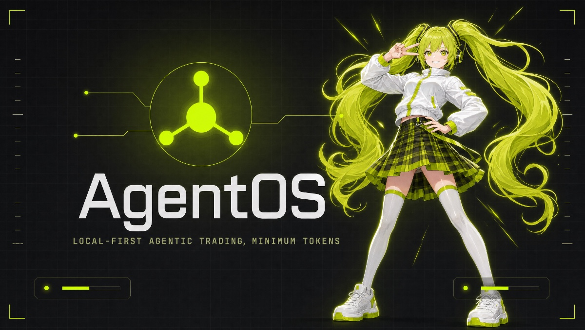
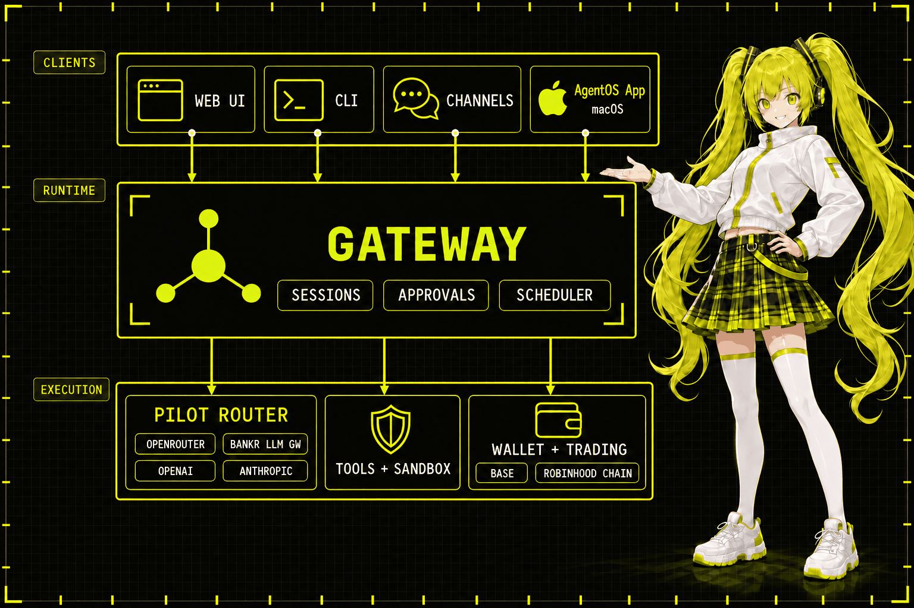

# AgentOS — The AI Agent That Trades for You, on Your Machine, with Your Keys

<p align="center">
  
</p>

<p align="center">
  <b>Local-first agentic trading.</b><br>
  Your agent swaps, bridges, DCAs, and sets stop-losses on Base and Robinhood Chain.<br>
  The keys stay in an encrypted vault on your machine, and guardrails bound every order.
</p>

<p align="center">
  <a href="https://github.com/use-agent-os/agent-os/actions/workflows/ci.yml"></a>
  <a href="https://useagentos.dev/"></a>
  <a href="https://x.com/useAgentOS"></a>
  <a href="https://github.com/use-agent-os/agent-os/releases"></a>
  <a href="https://www.python.org/downloads/"></a>
  <a href="LICENSE"></a>
</p>

<p align="center">
  <a href="https://github.com/use-agent-os/agent-os/releases/latest"><b>Download AgentOS for Mac &rarr;</b></a>
  &nbsp;·&nbsp;
  <a href="#installation">Windows and Linux</a>
  &nbsp;·&nbsp;
  <a href="docs/features/trading.md">Trading guide</a>
</p>

---

## What it does

AgentOS is an open-source AI agent that holds its own EVM wallets and
trades through the [AgentOS DEX](#agentos-dex). Ask it in chat, or run the same order
yourself from the desktop Trading Desk or the CLI:

```sh
agentos trade swap --chain base --in ETH --out USDC --usd 5                # swap $5 of ETH
agentos trade dca create <token> --usd 20 --every 1w --cap 500              # buy $20 a week, stop at $500
agentos trade trigger create <token> --below 10% --sell --pct 50            # sell half if it drops 10%
agentos trade bridge quote --chain base --to-chain robinhood --token ETH --usd 20
```

- **Swaps and sends** on Base and Robinhood Chain, quoted across 0x and Uniswap.
- **Bridges** between Base and Robinhood Chain, through whichever of Relay or Across delivers more.
- **DCA mandates, price triggers, and take-profit/stop-loss brackets** that run on a schedule, without you watching.
- **Uniswap V4 liquidity**: read pools and ranges, add, collect, and remove positions.
- **A ledger** that tracks cost basis and PnL for every wallet.

AgentOS 2026.11.26 is the current release. See the
[trading guide](docs/features/trading.md) for the full feature set and
the [CLI reference](docs/cli.md) for every command.

---

## Your keys, your limits

- **Keys never leave your machine.** Wallets live in a password-encrypted
  vault on your disk. The AgentOS DEX returns unsigned calldata; signing
  happens locally. The service holds no key and never broadcasts.
- **The gateway enforces the limits, not the model.** A prompt cannot talk
  its way past them.
- **You approve what matters.** Larger orders wait for you in the desktop
  app or the CLI.

| Guardrail | Default | What happens |
| --- | --- | --- |
| Per-order threshold | 100 USD | The order waits for your approval |
| Daily cap per wallet | 1,000 USD | The order is rejected |
| Price impact | 5 % | The order waits for your approval |
| Bridges and liquidity changes from an agent | always | The order waits for your approval |

> [!WARNING]
> Swaps move real money and cannot be undone. Start with small amounts,
> keep the daily cap low, and treat the vault directory like an SSH key.

Details: [guardrails](docs/features/trading.md#guardrails) ·
[approvals and permissions](docs/approvals-and-permissions.md) ·
[security policy](SECURITY.md).

---

## AgentOS DEX

[AgentOS DEX](https://dex.useagentos.dev/) is where AI agents trade onchain.
It gives agents a DEX to turn decisions into onchain trades: swap on Base,
Robinhood Chain, and Arbitrum One by form, by prompt in the
[AgentOS Terminal](https://dex.useagentos.dev/terminal), or over a keyless API.
It is built into the AgentOS Desktop App from the first launch, and the
trading features of AgentOS run through it: swaps, bridges, DCA mandates,
price triggers, and brackets.

| Through AgentOS DEX | Fee | How you see it |
| --- | --- | --- |
| Swap | 20 bps (0.20 %) | Shown in every quote, taken onchain by the AgentOS Router |
| Bridge (Base ⇄ Robinhood Chain) | 5 bps (0.05 %) | Shown in the bridge quote |

Network gas and the underlying bridge's own costs are paid as usual.

**Everything else is free.** AgentOS is Apache-2.0 licensed, and you bring
your own model provider key. The on-device Pilot Router sends each message
to the cheapest model that can handle it, so easy turns do not pay for a
large model.

---

## Also a full agent

Trading runs on a general-purpose agent, so the same assistant can research
a token, schedule a report, and message you the result.

| Capability | What it does |
| --- | --- |
| **Pilot Router** | Classifies each message and picks one of four tiers. The default is a small local model: it runs offline, and your message does not leave your computer for this choice. You can switch to [Jev](https://typesafe.ai/), typesafe.ai's hosted classifier (experimental; needs `TYPESAFE_API_KEY` and sends the current turn text to typesafe.ai). See [`docs/features/agentos-router.md`](docs/features/agentos-router.md#the-jev-strategy). |
| **20+ LLM providers** | OpenRouter (default), the Bankr LLM Gateway, OpenCAP, Surplus Intelligence, OpenAI, Anthropic, Ollama, DeepSeek, Gemini, Qwen/DashScope, and more, with fallbacks. No code or config rewrite to switch. |
| **50+ skills and MCP** | Coding, GitHub, deep research, market data, office files, and more, loaded only when a task needs them. AgentOS uses MCP tools and can serve as one. |
| **Local memory** | Markdown memory that persists between sessions, searchable by keyword and by meaning with an on-device embedding model. |
| **Sandbox** | Three safety levels. Bubblewrap on Linux and Seatbelt on macOS isolate tool runs; Windows has no OS sandbox yet. |
| **Every surface** | The AgentOS App, Web UI, CLI, Telegram, Slack, Discord, and Email share one gateway and one turn loop. |
| **Sessions and scheduling** | Durable sessions in SQLite, subagents, cron jobs, human approvals, and per-turn cost tracking. |

<p align="center">
  
</p>

More: [feature overview](docs/features.md) · [documentation index](docs/README.md) ·
[product guide](README.product.md).

---

## Installation

| Path | For | Needs |
| --- | --- | --- |
| [AgentOS for Mac](#agentos-for-mac) | macOS users | macOS 13 or newer |
| [Windows portable](#windows-portable) | Windows users | Nothing; Python is bundled |
| [Quick terminal install](#quick-terminal-install) | Any OS | `uv` (installed below) |
| [From source](#from-source) | Latest `main`, contributors | Git, Git LFS, Node.js 22+, `uv` |

The [install guide](docs/install.md) covers prerequisites, installer
options, Docker, and public network binding.

### AgentOS for Mac

Download the dmg from the
[latest release](https://github.com/use-agent-os/agent-os/releases/latest):
`AgentOS-<version>-arm64.dmg` for Apple silicon, `AgentOS-<version>.dmg`
for Intel. Drag it into Applications and open it. The app is signed and
notarized, installs the engine, starts the gateway, and updates itself.
See [`docs/desktop-app.md`](docs/desktop-app.md) for a tour.

### Windows portable

Download
<https://github.com/use-agent-os/agent-os/releases/latest/download/AgentOS-windows-x64-portable.zip>,
unzip it into a folder you can write to, and run `Start AgentOS.cmd`.
Preview builds are not signed yet; the
[install guide](docs/install.md#windows-portable-no-python) explains the
SmartScreen prompt and the alternatives.

### Quick terminal install

**1. Install `uv`.** Skip this if `uv --version` already works.

Linux / macOS:

```sh
curl -LsSf https://astral.sh/uv/install.sh | sh
. "$HOME/.local/bin/env"
```

Windows PowerShell:

```powershell
powershell -c "irm https://astral.sh/uv/install.ps1 | iex"
$env:Path = "$env:USERPROFILE\.local\bin;" + $env:Path
```

**2. Install and run AgentOS.**

```sh
uv tool install --python 3.12 "use-agent-os[recommended]"
agentos onboard
agentos gateway run
```

Then open <http://127.0.0.1:18791/control/>. If `agentos` is not found,
open a new terminal window.

To pin one exact version, add `==<version>` — for example
`uv tool install --python 3.12 "use-agent-os[recommended]==2026.11.26"` —
or use the release wheel directly:
`https://github.com/use-agent-os/agent-os/releases/download/v2026.11.26/use_agent_os-2026.11.26-py3-none-any.whl`.

> [!NOTE]
> Release install commands use published GitHub release assets.
> Python wheel installs use versioned wheel filenames, so there is no
> `latest` wheel alias. Only the Windows portable zip has a
> version-independent `releases/latest/download/` alias.

### From source

```sh
git lfs install
git clone https://github.com/use-agent-os/agent-os.git
cd agent-os
git lfs pull --include="src/agentos/memory/models/**"
git lfs pull --include="src/agentos/agentos_router/models/**"
bash scripts/install_source.sh
```

On Windows, run
`powershell -ExecutionPolicy Bypass -File ./scripts/install_source.ps1`
instead of the last line. To change the code, see
[Develop from source](docs/install.md#develop-from-source).

### Upgrade

```sh
agentos upgrade
```

This snapshots your config and state, installs the latest release, restarts
the gateway, and verifies it runs the new version. Your data in `~/.agentos/`
is not touched. Source installs re-run `bash scripts/install_source.sh`
instead. See the [upgrade reference](docs/install.md#upgrade) for flags,
manual upgrade commands, and version-skew rules.

### Coming from OpenClaw or Hermes Agent?

Run a dry run first, then apply:

```sh
agentos migrate openclaw --json
agentos migrate openclaw --apply
```

Use `hermes` in place of `openclaw`, or `agentos migrate --source
openclaw,hermes --apply` for both. See [`MIGRATION.md`](MIGRATION.md).

---

## Configuration

```sh
agentos onboard                    # first-run wizard: provider, router, channels, search
agentos configure provider         # change one section later
agentos gateway start --json       # run in the background at 127.0.0.1:18791
agentos chat                       # interactive chat in your terminal
agentos doctor                     # check providers, memory, sandbox, router, channels
```

For SSH or CI, pass the **name** of the environment variable that holds
your key, not the key itself:

```sh
agentos onboard --provider openrouter --api-key-env OPENROUTER_API_KEY
```

AgentOS reads the first config file it finds:
`AGENTOS_GATEWAY_CONFIG_PATH` → `./agentos.toml` → `~/.agentos/config.toml`
→ built-in defaults. Secrets set as environment variables always win. See
[`docs/configuration.md`](docs/configuration.md),
[`agentos.toml.example`](agentos.toml.example), and
[`docs/troubleshooting.md`](docs/troubleshooting.md).

---

## Credits

AgentOS is built on
[OpenSquilla](https://github.com/opensquilla/opensquilla)
(Apache-2.0) and influenced by
[OpenClaw](https://github.com/openclaw/openclaw) and
[Hermes Agent](https://github.com/NousResearch/hermes-agent). Other
tools and code used inside AgentOS are credited in
[`THIRD_PARTY_NOTICES.md`](THIRD_PARTY_NOTICES.md) and the root
[`NOTICE`](NOTICE) file.

## Contributing

We welcome bug reports, ideas, docs, new providers, channels, skills, and
core work. See [`CONTRIBUTING.md`](CONTRIBUTING.md), then open an issue or
pull request on [GitHub](https://github.com/use-agent-os/agent-os).

[Code of Conduct](CODE_OF_CONDUCT.md) · [Security](SECURITY.md) ·
[Support](SUPPORT.md) · [License](LICENSE) (Apache-2.0)
