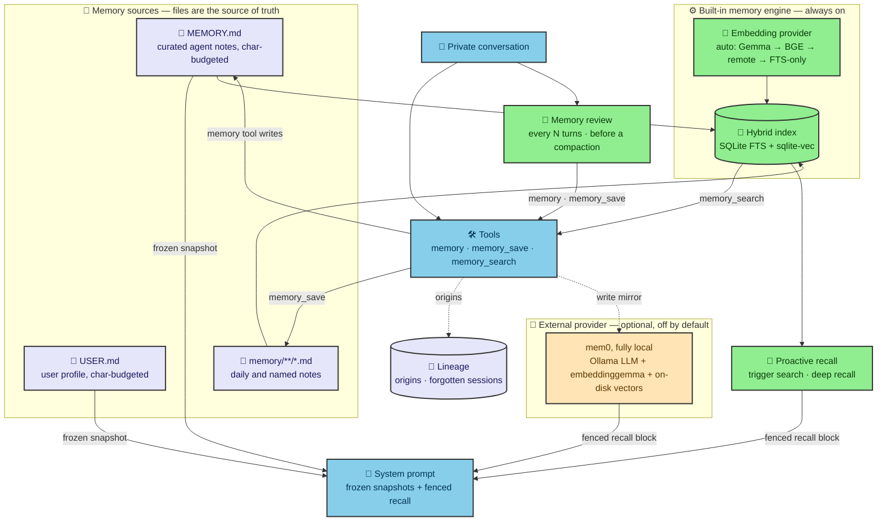
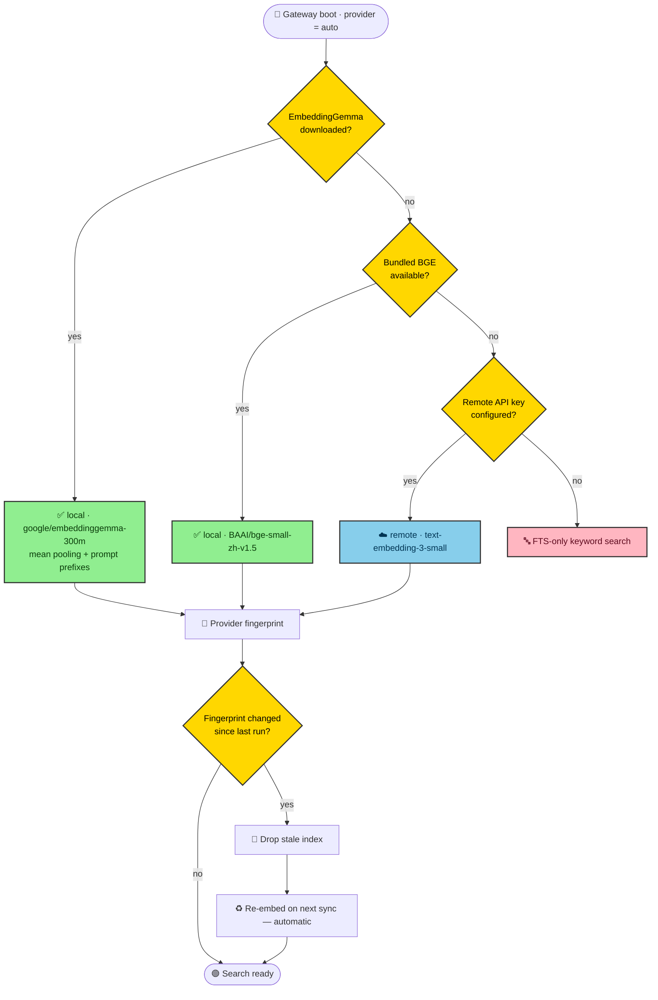
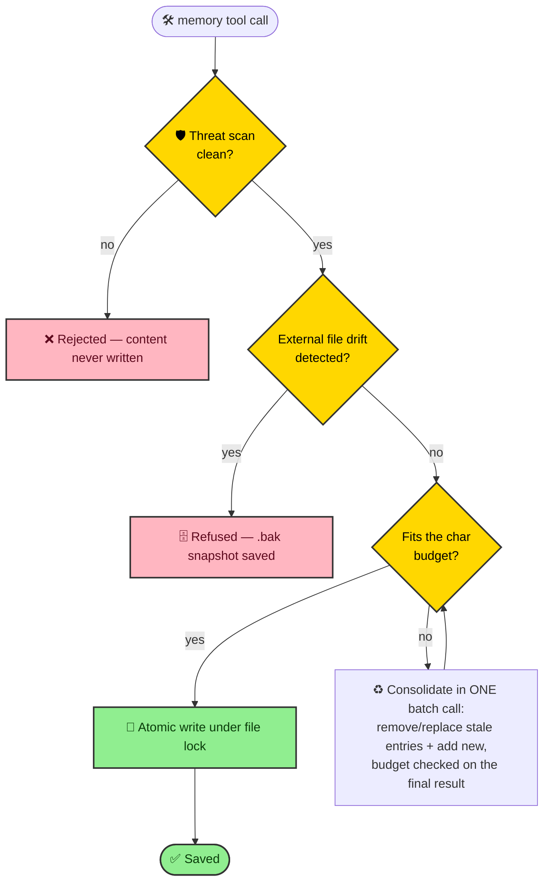
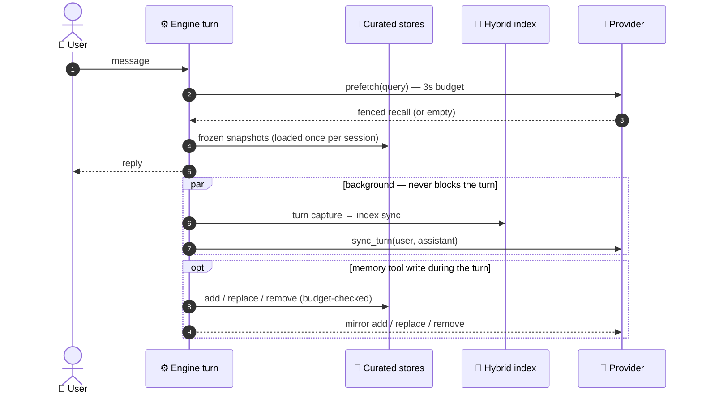

# Memory

AgentOS memory helps the agent recall durable context without replaying
every old conversation. Use it for stable preferences, reusable project facts,
previous decisions, and notes that should survive across sessions.

Memory is separate from skills. Skills teach the agent how to do a task; memory
stores useful facts and context the agent may need later.

## How it fits together



How a conversation becomes long-term memory: the model saves facts on its
own, or the [memory review](#how-conversations-become-memory) does it every
few turns and once more before a compaction summarises the conversation.
Those writes land in `MEMORY.md` (through the `memory` tool) or in dated
notes (`memory_save`), and notes are found again by search and proactive
recall. Every write records which session caused it, so
[forget](#lineage-and-forget) can remove what a session taught the agent.

## What to Store

Good memory entries are stable and reusable:

- user preferences;
- project conventions;
- recurring output formats;
- names of important repositories, directories, or services;
- decisions the user wants reused;
- brief notes from completed tasks.

Avoid memory for:

- API keys or secrets;
- raw private data that does not need long-term recall;
- one-off instructions for the current turn;
- noisy dumps that would pollute future retrieval;
- exact transcripts that should instead be exported as session records.

## Common Commands

Inspect memory health:

```sh
agentos memory status
agentos memory status --deep
```

Index and list memory sources:

```sh
agentos memory index
agentos memory list --source all
```

Ingest documents or folders into knowledge base:

```sh
agentos memory ingest /path/to/notes
agentos memory ingest /path/to/architecture.pdf
```

Curate agent notes and user preferences:

```sh
agentos memory curated get --target memory
agentos memory curated add "Always run unit tests before submitting PRs"
agentos memory curated remove "Always run unit tests before submitting PRs"
```

Search and inspect memory:

```sh
agentos memory search "release note format"
agentos memory show <path>
```

Search knowledge base, sessions, or all sources:

```sh
agentos memory search "deployment decision" --source knowledge_base
agentos memory search "deployment decision" --source all
```

## Natural Chat Usage

Ask naturally when something should be remembered:

```text
Remember that I prefer concise release notes with a risk section.
```

Later, refer to the preference:

```text
Use my usual release-note format for this changelog.
```

You do not have to ask the agent to search: proactive recall (below) looks
up memory for each message, and the agent is told to call `memory_search`
itself whenever an answer depends on past work it does not have in context.
When memory still seems stale, ask explicitly:

```text
Search memory for my release-note preferences before drafting this.
```

## Proactive recall

`MEMORY.md` and `USER.md` are always in the prompt, but notes under
`memory/**/*.md`, indexed sessions and the knowledge base are only reached by
search. Proactive recall runs that search for the agent before each
interactive turn, in two lanes:

1. **Trigger search** — every eligible turn. A lexical (keyword) search of
   the curated notes with the user's message. A note is injected only when
   it is a strong match: enough of the message's key terms appear in it (or
   its heading's terms appear in the message), scored deterministically
   against `trigger_min_score`. No embedding or model call, and bounded by
   `[memory] recall_timeout_seconds`.
2. **Deep recall** — only when the message asks about the past ("what did we
   decide last time", "do you remember", "hôm trước mình chốt gì", "còn nhớ
   … không") *and* the trigger search found nothing strong. A wider search
   (all sources, hybrid), the matching lines read from each note, and one
   small-model call that returns a short summary or `NONE`. Bounded by
   `deep_timeout_seconds`. Recall intent is detected by phrase patterns for
   English, Vietnamese (with or without diacritics), Spanish, Portuguese,
   French, German, Chinese, Japanese, Korean and Russian.

What is found goes into the turn's dynamic context (not the cached system
prompt) as a `## Recalled Memory` block, fenced in `<memory-context>` with a
note that it is background data, not user input, and capped at
`max_injected_chars`. If deep recall times out or fails, a one-line note says
so, so the agent does not take silence as "no memory". Nothing in either lane
can fail or block the turn beyond its deadline.

`mode` controls the deep lane: `escalate` (default) as above, `always` on
every eligible turn, `off` never (the trigger search still runs). Set
`enabled = false` to turn proactive recall off entirely.

**Which turns run it.** Only turns a person typed into a private,
interactive conversation: the web chat, the CLI, and direct messages on
channels. Heartbeat, cron and other background runs, sub-agent and ACP
children, inter-session messages and child-completion deliveries, group and
channel conversations, and stateless prompts are skipped.

**Model.** Deep recall is the auxiliary task `memory_recall`. By default it
uses the model the session is chatting with. The model is chosen in this
order, highest first:

1. `AGENTOS_MEMORY_RECALL_PROVIDER` / `AGENTOS_MEMORY_RECALL_MODEL`, then
   `[auxiliary.tasks.memory_recall]`: the operator's override.
2. `[memory.recall] provider` / `model`, when set.
3. The session's chat model for this turn. That is the model pinned on the
   session (`sessions.patch` / the session's model setting), else the agent's
   model, else a router hold already in place (`/use <model>` or
   `router_control`, while `[agentos_router]` is on), else the primary
   `[llm]` model. The call goes through the same provider, API key and base
   URL as the turn.
4. The auxiliary chain (`[auxiliary]`, then `[llm]`, then the built-in
   default). This applies only when there is no chat provider at all.

The router's per-turn tier choice is made after recall runs, so recall does
not wait for it. Without a pinned model, an agent model or a hold, recall uses
the primary `[llm]` model even when the router later sends the turn to another
tier.

Thinking is always off for the recall call, whatever the session's thinking
level. Providers whose models reason by default are sent their explicit
"no reasoning" setting (or the lowest effort the model accepts), so a
reasoning model does not run past `deep_timeout_seconds`. Recall still pays
the chat model's latency. If you chat with a large or slow model, set
`[memory.recall] model` to a fast one (or raise `deep_timeout_seconds`).

Tokens are recorded as `aux:memory_recall`. The model gets no tools: AgentOS
runs the memory search and line reads itself and hands it only those
excerpts.

```toml
[memory.recall]
enabled = true
mode = "escalate"              # escalate | always | off
trigger_min_score = 0.65
trigger_max_hits = 3
max_injected_chars = 1800
deep_timeout_seconds = 8.0
deep_max_summary_chars = 400
deep_max_results = 6
provider = ""                  # empty: inherit the session's chat model
model = ""
```

The same keys are in the web console in the **Proactive recall** card of
**Settings › Memory**, on the **Embeddings** tab.

**Per-session control and inspection.**

```sh
agentos memory recall status --session <session-key> --show-block
agentos memory recall pause --session <session-key>
agentos memory recall resume --session <session-key>
```

`status` shows the last outcome per session — `injected`, `none`,
`unavailable` or `error`, the lane decision, hit counts, elapsed time, the
deep-recall model with the rule that chose it — and with `--show-block` the exact block that was injected. A pause applies to
one session until it is resumed or the gateway restarts. Each turn also logs
a `memory.active_recall` event with the same fields. Over RPC these are
`memory.recall.status` and `memory.recall.set`.

## How conversations become memory

Durable facts from a conversation reach memory in three ways: the model saves
them on its own, you ask it to, or the **memory review** does it. The review
is a short background turn that re-reads the conversation and saves anything
durable it finds, with a memory-only tool set (`memory`, `memory_save`,
`memory_get`, `memory_search`, and for the periodic review `memory_delete`).
It never blocks a reply and never appears in the transcript.

It runs at two moments:

- **Every few turns** (`[memory.nudge] interval`, default 10 user turns),
  after the reply has been delivered. It is skipped for a turn in which the
  agent already wrote to memory on its own. This review goes through every
  message the user sent in the conversation, lists the durable facts in them
  (including ones mentioned in passing while asking for something else),
  checks each against what `USER.md` and `MEMORY.md` already hold, then adds
  what is missing and replaces values that changed (keeping the rest of the
  entry), one topic per entry. It leaves out small talk, passing moods and
  events, one-off questions and the task itself. Each run
  is logged as a `memory_nudge.review_done` event: what it wrote (target and
  action, never the text), and the review turn's own `input_tokens`,
  `output_tokens` and `iterations`. The review has no transcript entry, so
  that line is where its cost shows up.
- **Once before a compaction** (`[memory.nudge] before_compaction`, default
  `true`). A compaction replaces older messages with a summary, so this is the
  last chance to save what only those messages hold. The review runs right
  before a proactive or manual compaction (the web console's or
  `agentos chat`'s `/compact`) of a private chat, with a prompt saying that
  earlier messages are about to be summarised and only durable facts not yet
  saved should be written. It can only add: new `memory` entries and notes
  appended with `memory_save`. Replacing, removing or overwriting anything
  already saved is refused inside it, whatever the conversation asks for (the
  periodic review keeps those operations). It is bounded by
  `[memory.nudge] timeout_seconds`: compaction never waits longer, and comes
  out the same whether the review saved something, saved nothing, failed or
  timed out. A manual compaction can therefore take up to `timeout_seconds`
  longer than before. Afterwards the periodic count restarts.

  It is skipped, with a logged reason, when the compaction would summarise
  nothing anyway, which is known without a model call (the conversation still
  fits, or folding it would not save enough: `nothing_to_compact`), for a
  compaction forced by a full context (in-turn, or the gateway's overflow
  recovery: `no_headroom`), for cron, sub-agent, group and channel sessions,
  when a review ran in the last two user turns of the session
  (`recent_review`), and while one is already running for it (`in_progress`;
  a review still winding down after its deadline or after its compaction was
  cancelled counts, and can no longer start a memory write).
  `[memory.nudge] enabled = false` or `interval = 0` turns it off too. With
  `[compaction] proactive = false` only manual compactions get a review. A new
  message cancels a proactive compaction, and its review with it. Each
  decision is logged as a `pre_compaction_review` event with `outcome` `ran`,
  `timeout`, `error`, `cancelled` or `skipped` (plus `reason`), and
  `compaction`, `duration_ms` and `timeout_seconds`.

```toml
[memory.nudge]
enabled = true
interval = 10                 # user turns between reviews; 0 disables
timeout_seconds = 90.0
before_compaction = true      # one review before a proactive or manual compaction
```

Use session export when exact old wording matters:

```sh
agentos sessions export <session-key>
```

Memory is for useful recall. Session export is for exact records.

## Lineage and forget

Every write records its **origin**: which session caused it and how.

- The `memory` tool records each entry it adds or replaces, with the session
  and writer `tool` (or `review` for the memory review). A replacement keeps
  the replaced entry's origins and adds the current session; a removal drops
  the entry's origins. An add of an entry that already exists adds the
  session to it.
- `memory_save` records the block it wrote to its note.
- Curated edits through the CLI or RPC (`agentos memory curated ...`) record
  writer `operator` and no session.

Entries and note text written before this existed, or edited by hand since,
have no origin: they are **untracked** and never attributed to a session.
`agentos memory status --json` shows tracked and untracked counts for
`MEMORY.md` and `USER.md`.

```sh
agentos memory forget --session <id-or-key> [--session ...] [--agent <id>] [--dry-run] [--json]
```

A selector is a full session id (that transcript only) or a full session key
(every transcript under the key, including ones a later reset creates). A
prefix never matches: any selector that resolves to nothing stops the whole
command, changes nothing, and exits 2. Forget removes:

1. every curated entry with any origin from the selected sessions, whole; an
   entry that also came from other sessions is removed too and listed as
   `mixed`;
2. note blocks those sessions saved, under the rule below;
3. the sessions' derived index documents (with session indexing on), found
   by their path, so one indexed while the forget was running goes too;
4. best effort, the external provider's copies of the removed curated entries.

A note block goes only when it is provably theirs. Its text must still be a
complete block in the note (starting the note or after a blank line, ending
it or before one): a block the user edited or extended with another line is
listed as `unmatched` with reason `changed`. And every complete copy of that
text in the note must be attributable to the selected sessions: if another
session also saved it, if the note holds more copies than they saved, or if a
copy lies inside a block another session wrote, nothing is guessed and the
block is listed as `unmatched` with reason `ambiguous` and a `detail`
(`other_sessions`, `untracked_copies` or `overlaps_other_block`). Forgetting
all the sessions involved together removes such a shared block. Only the
removed text and one blank-line separator next to it are cut; every other
byte of the note, its line endings included, stays as it was.

The sessions are then recorded as forgotten: they are never indexed again.
Forgets of one agent run one at a time. `--dry-run` prints the same report and changes
nothing. The report (`--json`) has `sessions`, `curated`, `mixed`, `notes`,
`unmatched` (reason `changed`, `ambiguous`, `file_missing`, `unreadable` or
`invalid_path`), `sessionDocuments`, `staleOrigins`, `untracked`,
`providerMirrored`, `errors` (each with a stable `code`) and `notCovered`.
The command exits 1 when `errors` is not empty. Forget deletes an origin only
together with the text it points to: what it could not remove (an unreadable
or missing note or `MEMORY.md`, an edited or shared block) keeps its lineage,
so running the same forget again retries it. Removed text appears only in the
report's `curated` list; logs carry hashes, paths, counts and codes.

Forget is not erasure. It removes only what lineage attributes to the
sessions: it does not delete transcripts (use `agentos sessions delete`),
turn-capture files, compaction checkpoints, or untracked and hand-edited text,
and the report says so. A `MEMORY.md` the curated store refuses to rewrite
(drift) is reported, not rewritten. Over RPC this is `memory.forget`
(`agentId`, `sessions`, `dryRun`), Control-only.

Deleting a session (`agentos sessions delete`) removes its derived index
document, so search no longer returns it. What the session taught the agent
stays, with its origins: deleting a conversation is not a request to unlearn
it.

**`memory.db` holds more than the index.** The per-agent `memory.db` also
holds the origins and the list of forgotten sessions. `agentos memory index
--force` rebuilds only the index and keeps both; deleting `memory.db` to force
a reindex loses them, and a forgotten session would be indexed again.

## Embeddings and semantic search

Hybrid retrieval (the default) blends keyword (FTS) search with vector search.
Vectors come from an embedding provider selected by `[memory.embedding]`. In the
default `provider = "auto"` mode AgentOS picks the first available option in this
order:

1. A downloaded **EmbeddingGemma** model (higher quality, 768-dim).
2. The **bundled BGE-small** ONNX export (offline, ships with the recommended
   install).
3. A memory-specific **remote** embedding key, if one is configured.
4. **FTS-only** (keyword search) when nothing else is available.



### Upgrading the local model

The bundled BGE model works offline with no setup. To upgrade to EmbeddingGemma,
download its ONNX export once:

```sh
agentos memory embedding-download
```

The files land under `~/.agentos/models/embeddings/`. Use `--model <id>` to select
a different model; the default is `google/embeddinggemma-300m`. Auto mode then
prefers the downloaded model automatically — no config change required, but the
gateway must be restarted to pick it up (see below). To pin a specific
local model instead of relying on auto, set `[memory.embedding.local]`:

```toml
[memory.embedding.local]
model = "google/embeddinggemma-300m"  # or "BAAI/bge-small-zh-v1.5"
```

### Reindex on model switch

The active provider, model id, and ONNX directory are hashed into an embedding
**fingerprint**. Switching the local model (for example, after downloading
EmbeddingGemma or changing `[memory.embedding.local].model`) changes that
fingerprint, so existing vectors are never mixed across incompatible models.

Applying a new local model requires restarting the gateway (or a full
stop/start) — the provider is resolved once at boot, so `agentos memory index
--force` against an already-running gateway just reindexes with whichever
provider it already loaded, not the new one. Once the gateway has restarted
with the new model, the fingerprint change is detected automatically and a
full reindex happens on the next sync; no manual `--force` step is needed.

## Curated memory (MEMORY.md / USER.md)

Two small, bounded files are injected into every system prompt so the agent
always has the highest-signal facts on hand without a retrieval round-trip:

- `USER.md` — a short profile of the user: name, how to address them,
  pronouns, language, role, and how they like answers.
- `MEMORY.md` — every other durable fact: the user's work, the people in
  their life, their home, routines, schedules and plans, plus the agent's own
  notes (environment facts, conventions, tool quirks, lessons learned). It is
  the larger store, so most facts go here.

The agent is told to save a durable fact in the turn it comes up, including
one mentioned in passing while asking for something else; the memory review
catches what a turn missed. When a fact changes, it is told to replace the
entry holding it and keep every other detail of that entry. When a store is
nearly full, it is told to keep saving anyway (merge related entries, shorten
wordy ones, or use the other store if it has room) and not to drop a fact
that is still true just to make room. These are instructions to the model,
not checks: once `MEMORY.md` is at its limit a model can still overwrite an
entry it should have kept, so a store that stays full is worth reviewing.

Both stores live at the workspace root and are §-delimited lists of small
entries, not free-form prose. A new workspace (the main one and each
`workspace/agents/<id>/`) gets both files empty: everything in them is
injected as something the agent remembers, so they hold only what the agent
or you put there. What belongs in each is part of the system prompt's memory
guidance. Each store is char-budgeted rather than line- or entry-limited:

- `memory.curated_memory_char_limit` (default `4000`) bounds `MEMORY.md`.
- `memory.curated_user_char_limit` (default `2000`) bounds `USER.md`.
- `memory.inject_limit` (default `6400`) bounds the combined text actually
  injected into the system prompt. It is kept comfortably above the sum of
  the two budgets plus header overhead so a full `MEMORY.md` and a full
  `USER.md` both fit without either block being dropped. If a block would
  push the joined result over `inject_limit`, that block (and any
  lower-priority block after it) is dropped whole rather than sliced
  mid-block — memory is checked first, then user.

All three limits can also be adjusted from the gateway web UI, in **Settings ›
Memory** (the retrieval fields at the end of the section). Changes save through
`config.patch` and apply immediately — no gateway restart needed.

### The `memory` tool

Writes go through a single `memory` tool, not free-form file edits:

```json
{"action": "add", "target": "memory", "content": "Deploys with make deploy"}
{"action": "replace", "target": "user", "old_text": "prefers dark mode", "content": "Prefers dark mode and 2-space indent"}
{"action": "remove", "target": "memory", "old_text": "stale fact"}
```

`target` is `"memory"` (default) or `"user"`. Multiple changes in one turn
should use the batch shape instead, which applies atomically against the
*final* budget:

```json
{
  "target": "memory",
  "operations": [
    {"action": "remove", "old_text": "old deploy note"},
    {"action": "add", "content": "Deploys with make deploy"}
  ]
}
```

### Consolidation when full

An `add` (or a batch whose final result) that would exceed the store's char
limit is rejected with the current entries returned in the response, so the
agent can consolidate: `replace` overlapping entries or `remove` stale ones,
then retry — ideally in the same batch call so a single round-trip both
frees room and adds the new fact. Repeated consolidation failures within a
turn cap out after a few attempts so a fragile add/replace can't loop the
turn to budget exhaustion. The cap is counted per session, so two sessions
consolidating the same workspace's memory at once do not use up each other's
attempts.



### Drift guard (`.bak` files)

Each store expects its file to be a clean §-delimited list it wrote itself.
If an external writer (a patch tool, shell append, manual edit, or a
concurrent session) leaves content on disk that would not round-trip through
that format, the next `add`/`replace`/`remove`/batch call is refused rather
than silently rewriting the file over the foreign content. A timestamped
snapshot is written next to the file (e.g. `MEMORY.md.bak.<unix_ts>`) and the
tool response points at it; a refused retry against unchanged contents reuses
that snapshot instead of writing another. Every write stays refused until the
file is rewritten by hand as a clean §-delimited list (entries separated by a
line holding only `§`, no blank lines around it) — even a whitespace-only edit
such as a blank line before a `§` counts as drift.

Lowering `curated_memory_char_limit` / `curated_user_char_limit` below an
entry that is already in the file is not drift: that entry can still be
removed or replaced to get back under the new limit. The limit still applies
to what an add, replace or batch would leave behind.

### Migration note

Agents that had a free-form `MEMORY.md` (headings, bullet lists, paragraphs)
from before curated memory existed are migrated automatically, once, the
first time memory is loaded for a turn: the text is split into entries and kept
up to 80% of the char budget, with any remainder archived to
`memory/archive/memory-overflow.md` (still indexed and searchable — nothing
is lost). `MEMORY.md` is rewritten in place as a clean §-delimited list.

Workspaces created by earlier releases were seeded with instructions in both
files ("Use this file for…", an empty `- Name:` / `- Pronouns:` form, "Do not
store secrets…"), which the migration above split into eight `MEMORY.md`
entries. That text took about 16% of each budget and was injected as if it
were remembered. That text is now always left out: it is never listed,
counted, matched or injected. Reading never writes, so `agentos memory
status`, `agentos memory curated get` and `agentos memory forget --dry-run`
show a workspace that still holds it exactly as if it were gone, and leave
every file byte for byte as it was. The next turn removes it from the files
once (as does the first write to a file, whatever makes it), with the same
lock and atomic write as any other write and without a `.bak` file:

- An entry that is exactly the old template, or exactly one of the entries
  the migration made from it, is removed.
- A template you only added to (every template line still there, unchanged
  and in order, with values typed after `- Name:` and the like, or lines
  added) keeps what you added: the filled-in lines and the added lines stay,
  as one entry; the untouched template lines go.
- Anything else stays as it is, including an entry that quotes or rewords
  the template text, and a template with any line edited or deleted. Remove
  that by hand with `agentos memory curated remove` if you want it gone.

A file that would trip the drift guard is left for it. The removed text was
never written by the `memory` tool, so it had no lineage origin (the
`untracked` count in `agentos memory status --json` drops by the entries
removed) and nothing is sent to an external memory provider.

### `memory_save` scope

`memory_save` now targets only `memory/**/*.md` notes — it no longer accepts
`MEMORY.md` directly. Durable facts about the agent or the user go through
the `memory` tool described above instead.

## External memory providers

Built-in memory (the index and curated files above) is
always on. On top of it you can enable an **external memory provider** — an
extra recall/write layer that runs alongside built-in memory rather than
replacing it. It is **disabled by default**: with no provider selected the
layer is never imported and adds zero overhead.

When a provider is active it hooks four points:

- **Prompt block** — a recall block is assembled into the system prompt each
  turn, so relevant prior facts are available to the model up front.
- **Fenced recall** — recalled provider memories are wrapped in a clear fence
  in the prompt so they are attributable and cannot be confused with the live
  conversation.
- **Per-turn sync** — after each turn the user/assistant exchange is handed to
  the provider (serialized through one background queue per manager) so it can
  extract and store durable memories.
- **Write mirror** — every committed curated `memory` tool write (add,
  replace, remove, and each change in a batch) is mirrored to the provider
  on the same background queue, so it picks up new facts and drops edited or
  deleted ones. Replace and remove hand the provider the full text of the old
  entry. A duplicate add that changed nothing is not mirrored, and a failed
  mirror is logged without affecting the tool call.



### mem0 (fully local by default)

The bundled provider is [mem0](https://github.com/mem0ai/mem0). Its defaults
target a **fully local stack** so it works offline with no API keys and no data
leaving the machine:

- **LLM**: Ollama running `qwen3:4b` at `http://localhost:11434` (used to
  extract and summarize memories).
- **Embedder**: Ollama running `embeddinggemma` at the same endpoint.
- **Vector store**: an on-disk store under the agent state directory
  (`<agent state dir>/mem0`) when `vector_store_path` is left empty.

Install the optional extra (it is **not** a required dependency — `mem0ai` is
never imported unless the provider is selected):

```sh
pip install 'use-agent-os[mem0]'
```

The extra accepts `mem0ai` 0.1.70 up to (not including) 3.0. mem0 changed its
search API in 2.0 — the user scope moved from a `user_id=` keyword into
`filters={"user_id": ...}` and `limit` became `top_k` — and the provider
detects which one the installed client takes when it starts, so either works.
If a search is still rejected for its scope, the gateway log has a
`mem0_provider.prefetch_failed` warning with the call shape and the installed
`mem0ai` version; recall is empty until it is fixed.

Make sure Ollama is running and the two models are pulled:

```sh
ollama pull qwen3:4b
ollama pull embeddinggemma
```

### Configuration

Select and tune the provider under `[memory.provider]`:

```toml
[memory.provider]
name = "mem0"  # "" (disabled, default) | "mem0"

[memory.provider.mem0]
llm_provider = "ollama"
llm_model = "qwen3:4b"
llm_base_url = "http://localhost:11434"
embedder_provider = "ollama"
embedder_model = "embeddinggemma"
embedder_base_url = "http://localhost:11434"
vector_store_path = ""  # empty -> <agent state dir>/mem0
```

The same keys are editable in the web console under **Settings › Advanced**
(filter for `memory.provider`).

**Restart required.** The provider manager is built once at gateway boot, so
changing `memory.provider.name` — or any `memory.provider.mem0.*` setting —
only takes effect after a gateway restart. Settings shows a restart notice
naming the change when you save these keys.

**How curated writes reach mem0.** A curated entry is stored in mem0 verbatim
(no LLM extraction) as one record, tagged with its target and a hash of the
entry text. A `remove` searches mem0 for that text and deletes only the records
carrying both tags; a `replace` does the same and then adds the new entry.
Limits:

- Only mirrors written by a version with this tagging can be deleted. Curated
  adds mirrored by earlier versions went through mem0's fact extraction, carry
  no tags, and stay in mem0 until you delete them there.
- Facts mem0 extracted from the conversation itself (per-turn sync) are never
  deleted by a curated replace or remove, even when they say the same thing.
- The lookup inspects the top 20 search hits for the entry's text. A record
  that does not rank there (for example, after the embedder model changed) is
  missed and stays in mem0.
- An entry edited outside the `memory` tool (by hand, or through
  `agentos memory curated`) is not mirrored at all.

**Privacy.** With the default stack, everything (LLM, embeddings, vector
store) stays on the local machine. mem0 telemetry is disabled, so no usage
data is sent externally.

## Maintenance and Repair

Refresh the index after editing memory files or changing memory configuration:

```sh
agentos memory index --force
```

Inspect archived transcripts from sessions whose memory never landed:

```sh
agentos memory raw-fallbacks list
agentos memory raw-fallbacks show <path>
```

## Best Practices

- Keep entries short and sourceable.
- Prefer "Remember X for project Y" over vague "remember this."
- Search memory before assuming the agent forgot.
- Remove or revise stale preferences instead of adding contradictory ones.
- Keep secrets out of memory.
- Use artifacts or files for large reference material.

---

[Docs index](../README.md) · [Product guide](../../README.product.md) · [Improve this page](../contributing-docs.md) · [Report a docs issue](https://github.com/use-agent-os/agent-os/issues/new?template=docs_report.yml)
